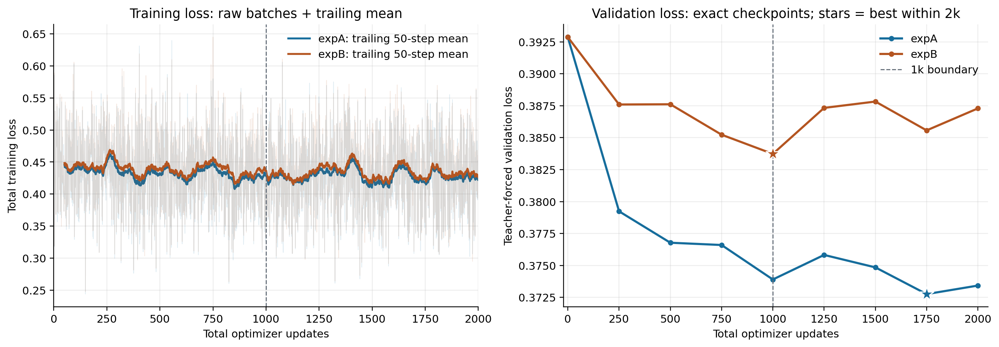

# ARTI5001 Assignment 3 · Group 62

本仓库供组员阅览 Tacotron2 + HiFi-GAN 语音合成项目的工作过程与现有实验结果。更新日期：2026-10-28。

## 阅读入口

- [完整工作日志](docs/PROJECT_RECORD.md)：数据检查、固定划分、模型加载、A/B 微调、文字预处理、试听诊断和提交整理。
- [最终结果与结论](results/FINAL_RESULTS.md)：1k/2k 终点、最佳检查点、人工反馈和评估限制。
- [结果表 CSV](results/final_comparison.csv)、[完整训练指标](results/training_metrics_0_to_2k.csv)、[验证曲线数据](results/validation_curve_data.csv)。
- [人工试听反馈](results/human_feedback.json)、[依赖版本](docs/requirements-lock.txt)。

## 实验概要

固定使用相同 2,000 条训练样本、1,310 条验证样本；expA 学习率为 1e-5，expB 为 5e-5。两组先训练至 1,000 步，再各自恢复至 2,000 步，其余条件保持一致。

| 实验 | 1k 验证损失 | 2k 终点验证损失 | 2k 预算内最佳步数 | 最低验证损失 |
|---|---:|---:|---:|---:|
| expA | 0.373902 | 0.373427 | 1750 | 0.372760 |
| expB | 0.383728 | 0.387289 | 1000 | 0.383728 |

人工试听未发现 1k→2k 的明显改善，部分地方退化，因此已停止追加训练。较低验证损失不能直接等同于更好的听感；小诊断集的 ASR WER 也不是自然度评分。

## 代码、Notebook 与试听

- [完整 Notebook](submission/62_A3/62_A3.ipynb)：已保存执行结果；默认关闭重新训练、新推理和 ASR。
- [训练和推理代码](scripts/)、[实验配置](configs/)、[固定划分](splits/)、[数据清单](data_manifests/)、[原始训练日志](logs/)。
- [试听页面文件](submission/62_A3/listen.html)、[110 段配套音频](submission/62_A3/wav_examples/)、[Notebook 证据 JSON](submission/62_A3/data/experiment_evidence.json)。
- [实验说明](EXPERIMENTS.md)、[微调说明](FINETUNING.md)、[环境依赖](requirements-lock.txt)。

### 如何查看与试听

1. 在线点击 Notebook 查看保存的文字、表格和图；GitHub 对大型 Notebook 或内嵌音频的显示可能受限。
2. 点击仓库 **Code → Download ZIP**，完整解压。
3. 用浏览器打开 `submission/62_A3/listen.html`，可并排试听 20 条句子的 110 段频谱重建及合成结果。GitHub 的 HTML 文件页只显示源码。
4. 用 Jupyter 打开 `submission/62_A3/62_A3.ipynb`，保留旁边的 `data/` 和 `wav_examples/`；默认 Run All 读取既有结果，不会训练。需要自行安装 Python 依赖。

没有上传原始 LJSpeech 数据集（包括真实录音）、模型权重、检查点和运行环境。训练、重新生成音频或数据完整性检查需要另外准备数据/权重；历史日志内的本机路径只是来源记录。旧诊断页面未全部上传，工作日志中相关路径可能指向本地归档。

现有 Notebook 已通过默认从头运行验证，没有重新训练。提交前仍需组员核对成员信息、分工与 AI 使用声明，并完成 PDF 报告和展示 PPT。尚未进行独立最终测试集评估；现有 10 条真实参照来自验证集。
